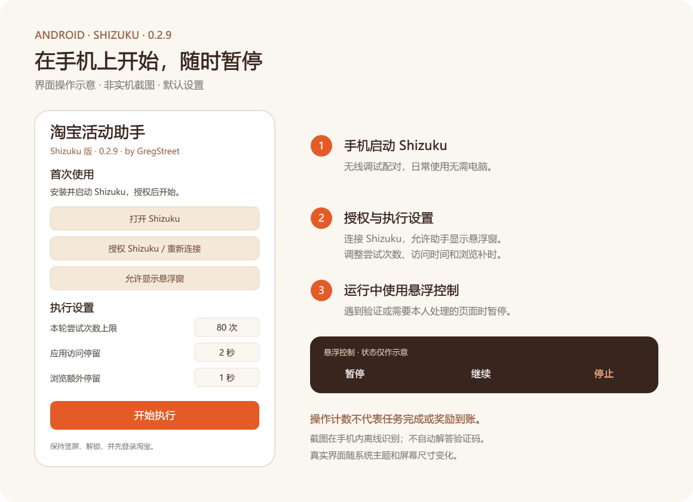

<p align="center"></p>

# 淘宝活动助手 · Android

在手机上通过 Shizuku 处理淘宝活动中的浏览、搜索与应用访问任务，支持悬浮暂停、继续和停止。

**版本 0.2.9 · Android 11+ · ARM64 · Shizuku 13+**

**[下载 APK](https://github.com/Greg-Street/tmall-miao-android/releases/latest) · [详细使用说明](docs/USAGE.md) · [反馈问题](https://github.com/Greg-Street/tmall-miao-android/issues)**

## 界面与操作

<p align="center"></p>

上图依据 0.2.9 的界面代码绘制，**是操作示意，不是手机实机截图**；图中运行状态仅用于讲解。真实外观随 Android 系统主题与屏幕尺寸变化。

## 功能

- 在主任务列表中依次处理支持的浏览、搜索和应用访问任务。
- 内置 80 个中文商品词，一轮内不重复；执行时可配置尝试次数与停留时间。
- 悬浮窗提供暂停、继续、停止；Shizuku 断线或需要人工处理时暂停。
- 遇到验证码、登录、授权或支付时交回本人处理，不自动解答或提交验证码。
- 截图使用内置 ML Kit 中文 OCR，在手机内存中离线识别，不保存截图。
- 普通淘宝浏览逐层返回；仅在已确认的跨应用访问后使用活动直达返回。

## 安装与启动

1. 在 [Releases](https://github.com/Greg-Street/tmall-miao-android/releases/latest) 下载 ARM64 APK 并安装。
2. 依照 [Shizuku 官方指南](https://shizuku.rikka.app/zh-hans/guide/setup/) 在手机上完成无线调试配对并启动 Shizuku。
3. 打开助手，点击“授权 Shizuku / 重新连接”，允许 Shizuku 和显示悬浮窗。
4. 确保淘宝已登录、屏幕解锁且保持竖屏，检查执行设置后点击“开始执行”。

日常使用不需要连接电脑，无需开启无障碍。手机重启后通常需要重新启动 Shizuku。历史同签名版本可覆盖安装；自行构建会使用自己的签名，不能保证覆盖发布包。

## 默认行为与边界

| 设置 | 默认值 |
| --- | --- |
| 本轮尝试次数上限 | 80 次 |
| 无明确浏览时长的应用访问 | 2 秒 |
| 明确浏览任务额外停留 | 1 秒 |
| 跨应用访问 | 允许 |
| 首页能量补充任务 | 已移除，主任务列表结束即结束本轮 |

“已执行”和“领取点击”是操作计数，不代表服务器判定完成或奖励到账。任务页面、活动规则与 OCR 结果都可能变化；失败会有限重试，无法恢复时暂停。0.2.9 已有 198 项离线测试记录，但运行负载与发热改善尚未在手机上实测。

## 权限与隐私

助手无联网、存储权限，不注册无障碍服务。Shizuku 用于截图、读取前台、点击、滑动、返回和输入，悬浮窗权限用于运行控制。

中文搜索会临时切换到内置输入服务，提交商品词后恢复原键盘。系统强杀或 Shizuku 中断时可能需要手动切回常用键盘。日志仅显示于本轮界面，开始新一轮时重置。

自动化操作仍可能触发平台限制，项目不保证任务收益或账号状态；平台要求人工完成的步骤应由本人处理。更多行为说明见 [USAGE.md](docs/USAGE.md)。

## 从源码构建

需要 JDK 17、Android SDK 35、Build Tools 35.0.0。项目自带 Gradle Wrapper：

```powershell
.\gradlew.bat --no-daemon --console plain testDebugUnitTest assembleDebug lintDebug
```

Linux / macOS 可运行 `./gradlew`。SDK 路径通过本机 `local.properties` 的 `sdk.dir` 或 `ANDROID_HOME` 配置，不要提交自己的 SDK 路径与签名文件。APK 输出到 `app/build/outputs/apk/debug/app-debug.apk`。

## 文档、反馈与来源

- [详细使用说明](docs/USAGE.md)
- [0.2.9 更新记录](docs/CHANGELOG.md)
- [构建验证与实测边界](docs/VALIDATION.md)
- [贡献与问题反馈](CONTRIBUTING.md)
- [图标生成与资源说明](docs/ICON.md)

感谢 [tmall-miao-double11](https://github.com/h0ll0w-AkuZr0guY/tmall-miao-double11)、[tmall-miao](https://github.com/MonsterNone/tmall-miao)、Shizuku 和 ML Kit。具体改编文件及依赖见 [ATTRIBUTION.md](ATTRIBUTION.md)。

**本仓库公开源码，目前没有工程统一的开源许可证。** 上游未附完整 LICENSE，后续使用和再分发前请阅读 [LICENSING.md](LICENSING.md)。
